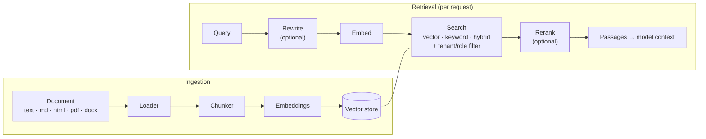

# Retrieval (RAG)

Agent349 includes a retrieval pipeline so agents can answer from your
documents: ingestion into collections, then vector, keyword or hybrid search
with optional query rewriting and reranking. Agent searches are always scoped
to the caller's tenant and roles.



| Component       | Built-in options                                                                             |
| --------------- | -------------------------------------------------------------------------------------------- |
| Vector store    | `in-memory` (default), `pgvector`, `qdrant`, `weaviate`, `milvus`, `pinecone`, `meilisearch` |
| Embeddings      | OpenAI, Cohere, Ollama                                                                       |
| Rerankers       | `llm` (any configured model), `cohere`, `tei` (Hugging Face Text Embeddings Inference)       |
| Query rewriting | `contextual` (resolves references from the conversation), `hyde`                             |
| Loaders         | plain text, Markdown, HTML, PDF, DOCX                                                        |

All of them are abstract classes you can extend (`VectorStoreAdapter`,
`EmbeddingProvider`, `RerankerProvider`, `DocumentLoader`).

## Configuration

```json config
{
  "rag": {
    "vectorStore": {
      "adapter": "meilisearch",
      "meilisearch": {
        "url": "${MEILI_URL}",
        "apiKey": "${MEILI_API_KEY}",
        "requestTimeout": 15000
      }
    },
    "embedding": {
      "defaultProvider": "openai",
      "defaultModel": "text-embedding-3-small",
      "defaultDimensions": 1536,
      "providers": { "openai": { "apiKey": "${OPENAI_API_KEY}" } }
    },
    "retrieval": {
      "searchMode": "hybrid",
      "hybridAlpha": 0.7,
      "topK": 15,
      "finalTopK": 5,
      "rerank": true,
      "rerankPolicy": "degrade"
    },
    "reranker": {
      "provider": "llm",
      "llmProvider": "claude",
      "model": "claude-haiku-4-5"
    }
  }
}
```

`orch.rag` is built lazily from this section on first access.

## Choosing a vector store

Every store implements the same `VectorStoreAdapter` contract. Tenant and role
scoping, tag, document, language and date filters, idempotent upserts, metadata
updates without re-embedding and bulk deletes behave identically on all of
them. The same test suite runs against each engine
([`tests/fixtures/vectorStoreContract.ts`](../../tests/fixtures/vectorStoreContract.ts)).
They differ in how they rank text and in a few limits:

| Adapter       | Engine                       | Keyword search                 | Hybrid search            | `filter.metadata` | Needs            |
| ------------- | ---------------------------- | ------------------------------ | ------------------------ | ----------------- | ---------------- |
| `in-memory`   | Process memory (development) | Token overlap                  | RRF                      | ✅                | —                |
| `pgvector`    | PostgreSQL + pgvector        | PostgreSQL full-text search    | RRF                      | ✅                | `npm install pg` |
| `qdrant`      | Qdrant, Qdrant Cloud         | BM25 (sparse vectors with IDF) | RRF                      | ✅                | —                |
| `weaviate`    | Weaviate, Weaviate Cloud     | Native BM25                    | Native (`alpha`)         | ❌                | —                |
| `milvus`      | Milvus 2.5+, Zilliz Cloud    | Native BM25 function           | RRF                      | ✅                | —                |
| `pinecone`    | Pinecone                     | ❌                             | ❌                       | ❌                | —                |
| `meilisearch` | Meilisearch                  | Native full-text               | Native (`semanticRatio`) | ignored           | —                |

Qdrant, Weaviate, Milvus and Pinecone are reached over their REST APIs, so they
need no client library. Unsupported operations fail with an explicit
`RAGError` instead of silently returning degraded results.

**pgvector.** Each collection is a table (`agent349_<collection>`) with an HNSW
index for the collection's metric (up to 2,000 dimensions; larger vectors are
searched exactly) and a generated `tsvector` column. The adapter runs
`CREATE EXTENSION IF NOT EXISTS vector` unless `createExtension` is `false`.
`textSearchConfig` (`simple`, `english`, `spanish`…) is fixed per collection
when it is created.

```json config
{
  "rag": {
    "vectorStore": {
      "adapter": "pgvector",
      "pgvector": {
        "connectionString": "${DATABASE_URL}",
        "schema": "public",
        "textSearchConfig": "english"
      }
    }
  }
}
```

**Qdrant.** One Qdrant collection per SDK collection, with a dense vector and a
BM25 sparse vector. Point IDs are deterministic UUIDs derived from chunk IDs.

```json config
{
  "rag": {
    "vectorStore": {
      "adapter": "qdrant",
      "qdrant": { "url": "${QDRANT_URL}", "apiKey": "${QDRANT_API_KEY}" }
    }
  }
}
```

**Weaviate.** One class per collection, named `Agent349_<collection>`
(collection names may use letters, digits, `_` and `-`). Stop words are
disabled so filters match tags and roles exactly. Custom metadata is stored
but not filterable.

```json config
{
  "rag": {
    "vectorStore": {
      "adapter": "weaviate",
      "weaviate": { "url": "${WEAVIATE_URL}", "apiKey": "${WEAVIATE_API_KEY}" }
    }
  }
}
```

**Milvus.** One collection per SDK collection, with a dense vector and a
sparse field filled by Milvus's BM25 function. Collections are created with
`Strong` consistency, so a write is visible to the next search; set
`consistencyLevel: "Bounded"` for higher ingestion throughput.

```json config
{
  "rag": {
    "vectorStore": {
      "adapter": "milvus",
      "milvus": { "url": "${MILVUS_URL}", "token": "${MILVUS_TOKEN}" }
    }
  }
}
```

**Pinecone.** All collections share one index (one namespace each), so they
share its dimension and metric. The index must exist, or `createIndex` creates
a serverless one on first use. Pinecone ranks by vector only: set
`searchMode: "vector"`, which the configuration loader enforces, and pass
`searchMode: "vector"` in direct `orch.rag.search()` calls. Serverless indexes
cannot delete or update by metadata filter, so `removeDocumentsByFilter()` and
`updateDocumentsMetadata()` scan the collection's namespace. Their cost grows
with its size.

```json config
{
  "rag": {
    "vectorStore": {
      "adapter": "pinecone",
      "pinecone": {
        "apiKey": "${PINECONE_API_KEY}",
        "indexName": "agent349",
        "createIndex": { "cloud": "aws", "region": "us-east-1" }
      }
    },
    "retrieval": { "searchMode": "vector" }
  }
}
```

**Your own store.** Extend `VectorStoreAdapter` and inject it with
`Orchestrator.create(config, { vectorStore: new MyStore() })`. An injected
store takes precedence over `rag.vectorStore`, and its lifecycle stays with
you. Stores built from configuration are closed by `orch.shutdown()`.

`rag.retrieval` settings are the defaults of the `rag.search` tool. A direct
`orch.rag.search()` call uses the values in its query, with `hybrid` as the
default mode.

## Ingestion

```ts
await orch.rag.createCollection('hr-policies', {
  embeddingProvider: 'openai',
  // "<provider>/<model>": queries embed with the provider named before the slash.
  embeddingModel: 'openai/text-embedding-3-small',
  dimensions: 1536,
  distanceMetric: 'cosine',
});

// A whole directory, visible to every employee of the tenant.
await orch.rag.ingestDirectory('./knowledge/hr', 'hr-policies', {
  extensions: ['.pdf', '.md', '.docx'],
  metadata: { tenantId: 'acme', accessRoles: ['employee'] },
});

// One restricted document, replacing any previous version with the same documentId.
await orch.rag.ingest('./knowledge/salary-bands.pdf', 'hr-policies', {
  metadata: {
    documentId: 'salary-bands',
    tenantId: 'acme',
    accessRoles: ['hr_admin'],
  },
  overwriteExisting: true,
});
```

- Always set `tenantId`, and `accessRoles` where access differs. Documents with
  no `accessRoles` are visible to everyone in the tenant.
- A stable `documentId` makes re-ingestion replace the old chunks instead of
  duplicating them. Content hashing also skips unchanged content.
- A collection is bound to one embedding model, written as
  `<provider>/<model>`. Searches embed the query with the provider named before
  the slash. Changing the model means re-ingesting into a new collection.

### Cross-document references

Regulations and procedures refer to each other ("see Annex XIV", "under Law 12.345"). With `rag.references.mode: 'follow'`, the passages that reach the
context are scanned for such references; each cited document is searched with
the same question (and the same query vector) and its passages join the result
only if they pass the re-ranker and `minScore`. Cited documents that are not in
the collection are reported in `trace.references.missing`, so the answer can
say so instead of answering half-way.

```json
"rag": { "references": { "mode": "follow", "maxTargets": 3, "perTarget": 3 } }
```

References are normalised to keys — `annex:14`, `law:12345`,
`decree:120/2015`, `regulation:679/2016`, `usc:12-1831` — so "Anexo XIV",
"anexo 14" and "Anexo N° 14" match, and so do "Decreto 120/15", "Decreto N°
120/015" and "Decreto 120/2015". Which words name which kind of norm comes
from the legal language profile (see _Legal languages_ below).

The SDK has no registry of your documents, so the host maps keys to
documentIds with `RAGQuery.resolveReferences` (or `createRAGTool(..., {
references })` in agentic mode). `ReferenceExtractor.identify(title)` gives the
keys that identify a document ("2 - ANEXO II - Decreto 120-15" → `annex:2`,
`decree:120/2015`) for that registry. The searches of cited documents keep the
tenant and role filters and drop the rest of the scope (tags, categories): a
reference made by the document applies whatever the user filtered, never past
the ACL.

Without a host registry, the SDK resolves keys on its own: at ingestion it
tags every chunk with the keys that identify its document (`ref:annex:14`),
and a reference is looked up by that tag (`rag.references.tagDocuments`,
default on when references or relations are on; a host that rewrites chunk
tags must keep them). `rag.legal.numberedTitles: true` makes a title like
"30 - ANEXO - Formularios" identify `annex:30` — a heuristic for collections that
number their annexes in file names, off by default.

The missing documents are data in the trace; `buildContextGuidance(result)`
turns them (and the status notes below) into instructions for the synthesis,
to append after the context. `createRAGTool` appends it to its output.

### Relations between documents

A newer rule often repeals or amends an older one, and the older one does not
mention it: following references forward never finds the change.
`rag.relations.mode: 'on'` looks the other way: when a document in the context
is repealed, amended or regulated by another, that one is searched with the
same question and joins the result if it passes the re-ranker and `minScore`;
both carry a note ("Repealed by Decree 1203/020 on 2020-05-04", "This document
repeals Decree 732/019").

```json
"rag": {
  "relations": { "mode": "on", "maxSources": 3, "perSource": 3 },
  "validity": { "mode": "on", "inactive": "flag", "priorityWeight": 0.1 }
}
```

`RelationExtractor` proposes relations from the operative wording of a
document — "Derógase el Decreto N° 732/019", "Modifícase el artículo 5 del
Decreto 654/018", "Law 123 is hereby repealed", "Fica revogada a Lei 8.078" —
with scope, articles and a strength (`explicit` when the sentence opens with
the verb and names one document). Narratives in the past ("the decree
repealed…") are not taken. Wording varies, so a detected relation is a
proposal: a host that lets people review them passes the result through
`RAGQuery.describeDocuments` with `status: 'proposed' | 'confirmed'`. Without
it, the relations tagged at ingestion (`rel:derogates:decree:732/19`) are used
as proposals.

### Document structure

Regulations are cited and amended by article, not as a whole.
`rag.structure.mode` makes ingestion aware of that:

```json
"rag": { "structure": { "mode": "split" } }
```

- `'label'` records, in every chunk, the articles and numbered sections it
  covers (`metadata.custom.section`; tags `art:12.2`, `sec:3.4.6`), the
  articles the document itself marks as repealed ("Artículo 70 (DEROGADO)")
  and the text that gave an article its current wording ("(Redacción dada
  por la Ley …)", or a closing "Circular 1234 de 15/03/2021" line as legal
  compilations write it).
- `'split'` also cuts the chunks at article and section headings, so that a
  chunk never mixes two articles (one in force and one repealed, for
  instance). It changes the chunking: re-index the collection to apply it.
  `IngestOptions.structure` sets the mode per document.

Headings are recognised at the start of a line with the words of the legal
language profile; tables of contents (dot leaders, page numbers), citations
("artículo 302 del Código Penal", "Section 5 of the Act") and list items are
not taken as headings. Numbered sections ("3.4.6") work in any language.

With structure:

- a relation that names articles ("modifies article 5") notes only the
  passages of those articles, and a confirmed partial repeal excludes only
  them under `inactive: 'exclude'`;
- an article repealed in the text gets a note, and is excluded under
  `inactive: 'exclude'` when its passage holds nothing else;
- internal references ("ver punto 4.2", "según el artículo 8", but not
  "el artículo 8 del Decreto 120/15") are followed within the same document
  when references are on (`rag.references.internal`, default true), through
  the unit tags, and reported in `trace.references.internal`;
- the source line names the unit: `Source: Norma — Artículo 12.1 (PLAZOS) [Circular 1234 de 15/03/2021]`.

### Legal languages

References, relations and structure read the text through a legal language
profile, `rag.legal`. Built-in packs follow the drafting conventions of each
language and its main traditions:

| Pack | Traditions                | Examples                                                                                                                               |
| ---- | ------------------------- | -------------------------------------------------------------------------------------------------------------------------------------- |
| `es` | Spain, Latin America      | "Artículo 5°", "Real Decreto 1720/2007", "Derógase…", "(Redacción dada por…)"                                                          |
| `pt` | Brazil, Portugal          | "Art. 5º", "§ 1º" and "Parágrafo único" (paragraphs), "Fica revogada a Lei nº…", "(Redação dada pela Lei…)"                            |
| `en` | US, UK, EU, international | "SEC. 101", "Section 5", "§ 1026.5", "12 U.S.C. 248", "Pub. L. 111-203", "S.I. 2017/692", "Directive 2006/48/EC", "is hereby repealed" |
| `fr` | France, Belgium           | "Article premier", "Art. 1er", "loi n° 78-17" (year-number), "est abrogé"                                                              |
| `it` | Italy                     | "Art. 2-bis", "decreto legislativo 30 giugno 2003, n. 196", "è abrogato"                                                               |
| `de` | Germany, Austria          | "§ 5", "Artikel 4", "(weggefallen)", "wird aufgehoben", "tritt außer Kraft"                                                            |

All packs are active by default: a collection that mixes local rules with EU
directives needs no setting. The `fr`, `it` and `de` packs follow the usual
conventions of those traditions; check them against your documents.

```json
"rag": {
  "legal": {
    "packs": ["es", "pt", "en", "fr", "it", "de"],
    "yearPivot": 30,
    "numberedTitles": false,
    "references": [{ "kind": "policy", "words": ["pol[ií]tica", "policy"] }],
    "relations": [{ "type": "derogates", "words": ["se\\s+deja\\s+sin\\s+vigor"] }],
    "structure": { "article": ["cl[aá]usula"], "repealed": ["sin\\s+vigor"] }
  }
}
```

- `packs` restricts the built-in packs.
- `yearPivot`: two-digit years up to it read as 20YY, above as 19YY (default:
  the current two-digit year + 1).
- `references`, `relations`, `structure`: the installation's own words
  (regular-expression fragments, case-insensitive) — kinds of norms, operative
  verbs, heading words, repeal and wording markers, internal-reference words.
  `references` also takes a full `pattern` with capture groups and an `order`
  (`number/year` or `year/number`).

Identifiers keep the full year: number/year ("120/15" → `120/2015`),
year/number when the context marks it (EU "(UE) 2016/679", "2006/48/EC") or
the shape does ("2018/293": a year, then a number that cannot be one), and a
pack's own order (France, "78-17" → `17/1978`). Series letters ("Comunicación
A 7000" → `a-7000`) and bis/ter are kept. A year that belongs to a title
("Companies Act 2006") is not an identifier.

### Validity, version and priority

`rag.validity.mode: 'on'` reads, per document, `validFrom`, `validTo`,
`version` and `priority` (`high` / `normal` / `low`) — from
`RAGQuery.describeDocuments` or from `metadata.custom` of the chunks. An
expired document, or one repealed in full by a confirmed relation, is
_inactive_: flagged by default, left out with `inactive: 'exclude'` (a
proposed relation only warns, it never excludes; the replacing document is
still searched). Priority adds or subtracts `priorityWeight` to the score
before the final cut. Read at query time, so changing a date needs no
re-indexing.

Notes reach the model as a `Status:` line under each passage
(`formatForContext`; `noteText` renders them in your language), and
`trace.status` records the notes, exclusions and related documents searched.

### OCR of scanned documents

With `rag.ocr.enabled`, the PDF loader keeps the text layer of each page and
recognises only the pages without one (scanned) with Tesseract; images (PNG,
JPEG, TIFF, BMP, WebP) are recognised too. It needs the optional dependency
`tesseract.js` and the language data — `<lang>.traineddata` files in
`langPath` — and never goes online unless `allowDownload` is true.

```json
"rag": {
  "ocr": {
    "enabled": true,
    "languages": ["spa", "eng"],
    "langPath": "./tessdata",
    "minChars": 80,
    "concurrency": 1,
    "idleTimeoutMs": 60000,
    "pageTimeoutMs": 120000,
    "escalate": { "enabled": false, "belowConfidence": 70, "llmProvider": "openai", "model": "gpt-6.1-terra" }
  }
}
```

All the work — reading the PDF, rendering the pages, recognising them — runs
in worker threads, off the host's event loop. A worker exists only while there
is work: it is created for the first file, processes pages one at a time, and
is terminated after `idleTimeoutMs` without work (freeing the Tesseract model,
a few hundred MB with pdf.js). A page that exceeds `pageTimeoutMs` terminates
the worker; the next file gets a new one. `concurrency` is the number of files
at once (one worker each). A document's `language` metadata picks the
Tesseract language (`es` → `spa`).

`escalate` re-reads the pages Tesseract recognised with low confidence with a
vision model through the LLM router (a cloud model or a local Ollama one);
its tokens are recorded. Off by default.

Hosts can use the service directly, without an Orchestrator:

```ts nocheck
import { OcrService } from 'agent349';
const ocr = new OcrService({ languages: ['spa'], langPath: '/opt/app/tessdata' });
const { text, pages, ocrPages, avgConfidence } = await ocr.extractPdf(pdfBytes);
await ocr.close();
```

### Answer verification

Retrieval can bring the right passage and the answer still add a figure, a
condition or a step the passage does not contain, or apply a rule to a case
it does not cover. `rag.verification` adds a check after the synthesis:

```json
"rag": {
  "verification": {
    "mode": "blocking",
    "model": "a-small-model",
    "onUnsupported": "repair",
    "onNotApplicable": "annotate",
    "onUncertain": "deliver",
    "onError": "deliver",
    "afterRepair": "annotate"
  }
}
```

```typescript
import { decideVerification, verificationNotice, type Passage } from 'agent349';

declare const question: string;
declare let answer: string; // the synthesis output
declare const passages: Passage[]; // the passages given to the synthesis

const result = await orch.rag.pipeline.verifyAnswer({ question, answer, passages }, context);
switch (decideVerification(result, orch.rag.pipeline.verification.policy)) {
  case 'deliver':
    break;
  case 'repair':
    /* synthesise again with buildRepairInstruction(result), verify once more */ break;
  case 'annotate':
    answer += '\n\n' + verificationNotice(result);
    break;
  case 'abstain':
    answer = '…';
    break;
}
```

The verifier lists the claims of the answer and classifies each one against
the passages, decides whether the passages apply to the situation asked, and
gets the figures of the answer that appear in no passage as a hint (passages
may spell numbers out, so they are not a verdict on their own). The result is
`pass`, `fail` (a claim unsupported or contradicted, or the passages do not
apply), `uncertain` (partial support, uncertain applicability) or `error`
(the check could not run: provider error, `timeoutMs`, unreadable reply).

`mode` is advice for the host, which owns the delivery: `'blocking'` checks
before showing the answer (no answer is shown and then withdrawn; adds the
verification latency), `'after'` shows it and adds a notice when the check
fails. A repaired answer cannot be repaired again: `afterRepair` decides.

## Giving agents access

`rag.search` is a regular tool. Create one bound to your collections and put it
in a skill:

```ts
import { createRAGTool } from 'agent349';

const searchPolicies = createRAGTool(orch.rag.pipeline, ['hr-policies']);
orch.registerTool(searchPolicies);
orch.registerSkill({
  name: 'hr-knowledge',
  description: 'Search HR policies',
  tools: [searchPolicies],
  systemPromptAddition: 'Answer policy questions only from search results, and cite them.',
});
orch.registerAgent({
  id: 'hr-assistant',
  name: 'HR assistant',
  systemPrompt: 'You answer questions about company policies.',
  skills: ['hr-knowledge'],
});
```

It can also be declared in configuration as an internal tool:
`{ "name": "rag.search", "kind": "internal", "ref": "rag.search", "config": { "collections": ["hr-policies"] } }`.

## Searching directly

```ts
const result = await orch.rag.search(
  {
    query: 'remote work policy',
    collections: ['hr-policies'],
    topK: 10,
    finalTopK: 4,
    searchMode: 'hybrid',
    hybridAlpha: 0.6,
    rerank: true,
    // Direct searches are not scoped automatically: pass the caller's scope.
    filters: { tenantId: context.tenantId, accessRoles: context.roles },
  },
  context,
);

for (const p of result.passages)
  console.log(p.collection, p.score.toFixed(3), p.content.slice(0, 80));
console.log('latency', result.metrics.totalLatencyMs, 'ms');
```

### Search trace

`result.trace` explains the result: the query actually searched (after any
rewrite), whether the rewrite was applied or why it fell back, and every
candidate with its scores and where it ended up. It carries identifiers and
scores only, never passage text, so it can be stored next to a conversation.

```ts
const { passages, trace } = await orch.rag.search(
  { query: 'remote work policy', collections: ['hr-policies'], rerank: true, minScore: 0.25 },
  context,
);
if (trace.rewrite?.fallbackReason !== undefined)
  console.warn('rewrite fell back:', trace.rewrite.fallbackReason, trace.rewrite.error);
if (passages.length === 0)
  console.log(
    trace.candidateCount === 0
      ? 'no candidates'
      : `${trace.droppedByMinScore} candidates below minScore ${trace.minScore}`,
  );
for (const c of trace.candidates)
  console.log(c.documentId, c.chunkIndex, c.retrievalScore, c.rerankScore, c.stage);
```

### Stop words and glossary

`rag.lexicon` handles the vocabulary of the query the same way on every
vector store: nothing is configured in the engine.

```json
"rag": {
  "lexicon": {
    "stopWords": "auto",
    "languages": ["es"],
    "glossaryFile": "./config/glossary.txt"
  }
}
```

- **Stop words** affect only the keyword component of the search; the
  vector component always gets the full question, where function words
  carry meaning. The built-in lists (es, en, pt, fr, it, de) hold only
  function words, and negations or exclusions ("no", "sin", "not", "only",
  "não", "nicht"…) are never removed, whatever the lists say. `languages`
  picks the lists (all of them when absent; `RAGQuery.languages` overrides
  it); `extraStopWords` and `keepWords` tune them; a list replaces them.
  Languages without spaces between words (Chinese, Japanese) are left to
  the engine. Off by default.

  `stopWordsMode` chooses where they apply: `'native'` (the engine),
  `'query'` (the SDK removes them from the keyword query, the same on every
  engine) or `'auto'` (default: native when the engine supports it, query
  otherwise).

  | Engine                      | Native stop words                                                                                                                           | When                                   |
  | --------------------------- | ------------------------------------------------------------------------------------------------------------------------------------------- | -------------------------------------- |
  | Meilisearch                 | `stopWords` index setting (SDK words)                                                                                                       | Any time; re-indexes in the background |
  | Weaviate                    | `invertedIndexConfig.stopwords` (preset `none` + SDK words); only the query is filtered                                                     | Any time                               |
  | pgvector                    | Text-search configuration of the language (`spanish`, `english`…): PostgreSQL's own dictionary **and stemmer**; one language per collection | Any time; rewrites the `tsv` column    |
  | Milvus                      | Stop filter of the BM25 analyzer (SDK words)                                                                                                | Only at creation                       |
  | Qdrant, Pinecone, in-memory | None: applied from the query                                                                                                                | —                                      |

  Native stop words are set per collection: `createCollection(name, { languages })`
  creates it with them, and `configureCollection(name, { languages })` applies
  them to an existing one — or clears them when stop words are off or the mode
  is `'query'`, so they are not applied twice. Call it when the collection's
  languages or the stop-word settings change, not per search: on Meilisearch
  and pgvector it rewrites the index. `trace.lexicon.stopWords` says where they
  applied. The Milvus analyzer parameters follow Milvus's documented stop filter
  but have not been run against a live Milvus server yet.

- **Glossary**: acronyms, jargon and internal names the embeddings cannot
  know. One entry per line:

  ```text
  # comments start with '#'
  KPI = key performance indicator
  HR, human resources = the department that manages staff and payroll
  PTO, annual leave, vacation
  ```

  `glossaryFile` is the installation glossary; a search adds the collection's
  with `glossary` (`parseGlossary(text).entries`), which wins on shared terms.
  The entries whose terms occur in the question (or in the last user turn)
  are given to the query rewriter and the query expander, which add the
  meaning or the equivalents to the search. Without a rewriter or expander
  the glossary has no effect. With history the rewriter runs anyway; on a
  first question it runs only because of the glossary — one extra model call
  on the questions that use a glossary term. `glossaryRewrite: false` limits
  the glossary to follow-ups and to the expander. `trace.lexicon` reports the keyword text and the
  glossary terms used.

### Query expansion

Users ask colloquially, misspell, or use other words than the documents. With
`rag.queryExpansion`, a small model writes a few alternative formulations of
the question (formal terminology, corrected spelling, keywords); each is
searched and the result lists are fused by reciprocal rank before re-ranking.
The re-ranker and the answer still use the original question, so a poor
variant can add a candidate but not change what is answered.

```json
"rag": {
  "queryExpansion": {
    "mode": "fallback",
    "llmProvider": "openai",
    "model": "gpt-6-luna",
    "reasoningEffort": "minimal",
    "variants": 3,
    "fallbackBelow": 0.4,
    "maxCandidates": 40,
    "context": "Internal policies and procedures of the company."
  }
}
```

| `mode`       | When it expands                                                                                                                                             | Cost                                             |
| ------------ | ----------------------------------------------------------------------------------------------------------------------------------------------------------- | ------------------------------------------------ |
| `'off'`      | Never (default)                                                                                                                                             | —                                                |
| `'fallback'` | Only when, after re-ranking, no candidate reaches `fallbackBelow` (default: `minScore`) or there are none; it then searches the variants and re-ranks again | Only on the searches that found nothing relevant |
| `'always'`   | Every search, before re-ranking                                                                                                                             | One extra call and searches per query            |

`fallback` needs a re-ranker to judge relevance; without one it expands only
when there are no candidates. A single search can override the mode with
`expansion: 'always' | 'fallback' | 'off'` (the expander is built whenever the
section exists, even with `mode: 'off'`). A failed expansion never fails the
search: it goes on with the original query and the trace says why
(`trace.expansion.error`). `trace.expansion.variants` lists the queries
searched and each candidate's `foundBy` says which searches returned it (`0`
is the query itself).

`formatForContext()` labels each passage with the document title (falling back
to `source`, then `documentId`), so internal paths and URLs do not reach the
model. Pass `{ sourceLabel: 'source' }` to label with the source instead.

## Access control

When an agent searches through the `rag.search` tool, the tool adds the
caller's `tenantId` and roles from the `ExecutionContext` to the vector-store
filter. The model cannot override them. Two users asking the same question can
get different passages.

When your code calls `orch.rag.search()` directly, it is trusted code and no
scope is added. Pass `filters: { tenantId, accessRoles }` yourself, as in the
example above.

Who may search at all is ordinary tool ACL:

```ts nocheck
acl.addPolicy({ resourceType: 'tool', resourceId: 'rag.search', allowedRoles: ['employee'] });
```

## Tuning notes

- `hybrid` suits most corporate content. Use `keyword`, or a low `hybridAlpha`,
  for codes, IDs and proper names.
- Without a reranker, scores are normalized per collection (the best candidate
  is always 1.0), so `minScore` cannot tell "no relevant result" apart from
  "some result". Enable a reranker if that distinction matters.
- The `llm` reranker scores every candidate in one call against a fixed
  rubric (1.0 answers the query, 0.7 most of the answer, 0.4 same subject
  without the answer, 0.1 tangential, 0.0 unrelated), so `minScore` reads as
  a level: around 0.5 keeps passages that contain at least part of the
  answer. Calibrate it with your own questions. Small models are cheaper but
  less stable; `samples: 3` averages three passes.
- `rerankPolicy: "require"` fails the search when the reranker is down.
  `"degrade"` falls back to un-reranked results.
- Call `orch.validateModels()` at startup. It sends each configured model —
  default LLM, embedding, reranker, query rewriter — the request it really
  sends, and reports which ones fail. The query rewriter needs it most: a
  rewriter that cannot reach its model never fails a search, it silently
  searches the original text, so conversational follow-ups lose their context.

  ```ts
  const report = await orch.validateModels();
  for (const m of report.models)
    if (m.configured && !m.available) console.error(`${m.role} ${m.model}: ${m.error}`);
  ```

- Embeddings and LLM reranking are recorded in token accounting, attributed to
  `rag.ingest` and `rag.search`.

For chunking strategies, loaders, metadata updates and multi-collection search,
see the Spanish [RAG manual](../es/RAG_MANUAL.md).
